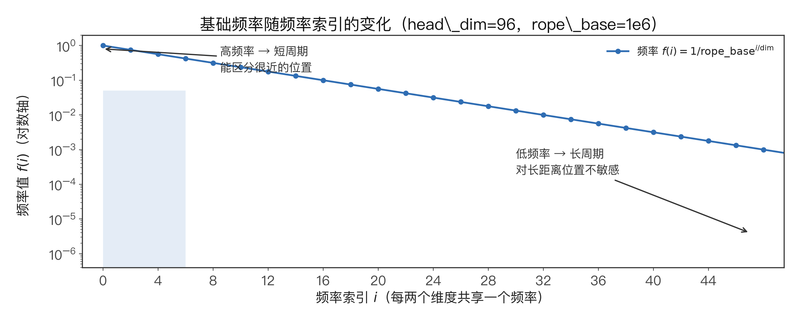
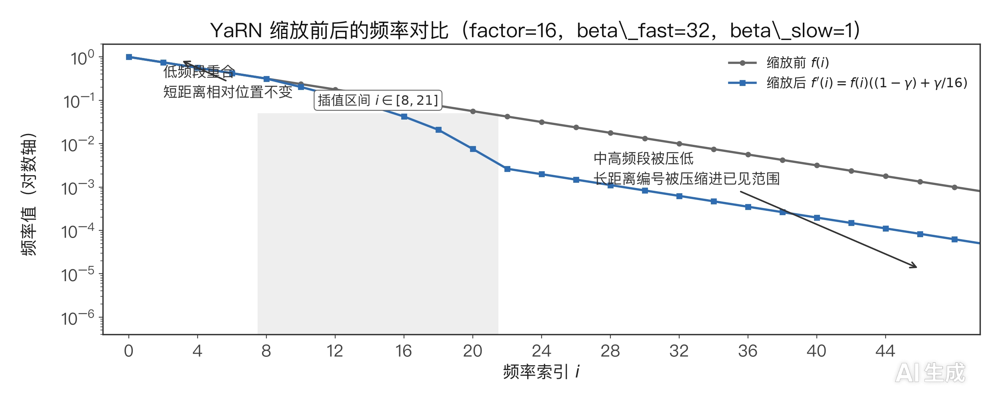
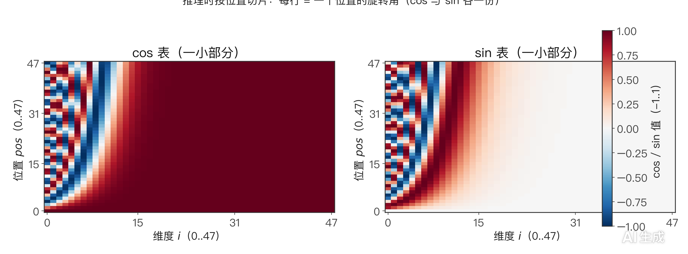
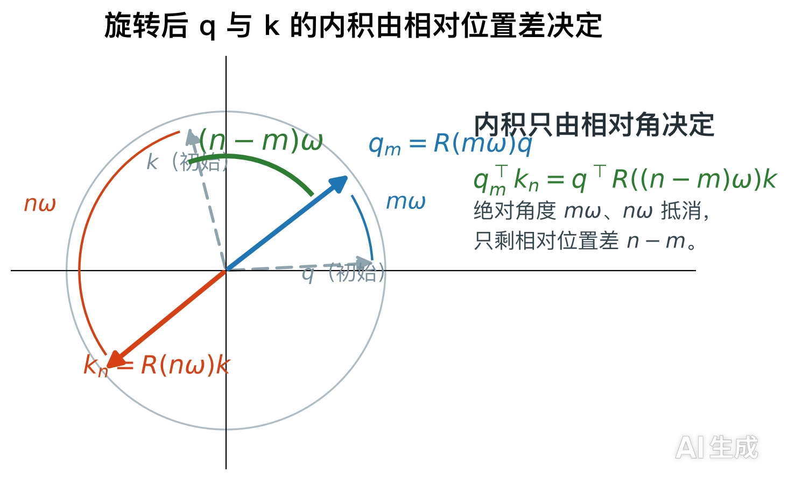

# 理解 RoPE 与 YaRN：频率计算、旋转角度和长上下文扩展

RoPE（Rotary Position Embedding，旋转位置编码）通过旋转 Query 和 Key 的向量维度，将位置信息融入 Transformer 的注意力计算。

## 首先 RoPE 的基础频率是如何计算的？

### 我们用二维旋转理解维度配对

假设一个 Token 经过线性变换后，得到一个 4 维的 Query 向量。

$$
\mathbf{q}=[q_0,q_1,q_2,q_3]
$$

RoPE 会将参与旋转的维度组成若干对，每一对维度对应一个旋转角度。对于标准的二维旋转，可以写成：

$$
\begin{bmatrix}
q'_0\\
q'_1
\end{bmatrix}
=
\begin{bmatrix}
\cos\phi & -\sin\phi\\
\sin\phi & \cos\phi
\end{bmatrix}
\begin{bmatrix}
q_0\\
q_1
\end{bmatrix}
$$

这里的 \(\phi\) 是当前 Token 在对应频率维度上的旋转角度。

每次旋转需要**两个维度**，因此标准 RoPE 要求参与旋转的维度能够两两配对。对于完整应用 RoPE 的情况，旋转维度通常是偶数。

实际 Transformer 中，需要关注的是每个注意力头的维度 `head_dim`，或者实现指定的旋转维度 `rotary_dim`。例如，模型隐藏维度为 12、注意力头数为 4 时，每个头的维度是 3。这样的配置不能直接套用要求完整偶数维旋转的标准实现。

维度的配对顺序由代码决定。某些实现将相邻维度配成一对，例如 \((q_0,q_1)\) 和 \((q_2,q_3)\)；MiniMind 使用 `rotate_half` 的实现通常采用前后两半维度配对，例如 \((q_0,q_2)\) 和 \((q_1,q_3)\)。两种布局都可以表达二维旋转，但必须与对应的 `cos`、`sin` 表保持一致。

### 接下来根据维度索引生成基础频率

理解了维度配对之后，再看频率计算代码。

```python
freqs = 1.0 / (
    rope_base ** (
        torch.arange(0, dim, 2).float() / dim
    )
)
```

其中，`dim` 表示这段代码所处理的旋转维度，`rope_base` 是频率基数，通常记为 \(\theta\)。

代码中的 `torch.arange(0, dim, 2)` 每隔两个维度取一个索引。对于偶数维度 \(d\)，它会生成：

$$
0,2,4,\ldots,d-2
$$

将这些索引除以 \(d\)，再作为 `rope_base` 的指数，最终得到基础频率。

对应的数学公式为：

$$
\omega_i=\frac{1}{\theta^{2i/d}}
$$

这里：

- \(i\) 是频率索引，从 \(0\) 开始。
- \(d\) 是参与旋转的维度数。
- \(\theta\) 对应代码中的 `rope_base`。
- \(\omega_i\) 是第 \(i\) 组维度使用的旋转频率。

因为代码从维度索引 \(0,2,4,\ldots\) 取值，所以第 \(i\) 个频率对应的指数是 \(2i/d\)。

当 \(i=0\) 时：

$$
\omega_0=\frac{1}{\theta^0}=1
$$

此时频率最大。随着 \(i\) 增大，指数逐渐增大，频率也就逐渐减小。

例如，当 \(d=96\)、\(\theta=10^6\) 时，频率索引的范围是 \(0\) 到 \(47\)。最后一个频率为：

$$
\begin{aligned}
\omega_{47}
&=\frac{1}{(10^6)^{94/96}}\\
&\approx 1.26\times10^{-6}
\end{aligned}
$$

于是，同一个注意力头中的不同维度对会获得不同的旋转频率。


值得注意的是所有token共享同一张频率表
---

---

对于token的位置 \(p\)，第 \(i\) 个频率对应的旋转角度为：

$$
\phi_{p,i}=p\omega_i
$$


频率 \(\omega_i\) 决定每经过一个 Token，角度增加多少。位置 \(p\) 决定当前 Token 累积到的总相位。

例如，假设某个维度对所在的频率为 \(0.1\)，那么位置 \(0\) 到位置 \(4\) 对应的角度分别是：

| Token 位置 \(p\) | 旋转角度 \(\phi_{p,i}\) |
|---:|---:|
| 0 | 0 |
| 1 | 0.1 |
| 2 | 0.2 |
| 3 | 0.3 |
| 4 | 0.4 |

这里的角度随位置线性增长。代码会直接根据位置计算每个 Token 的角度，并不需要读取前一个 Token 的角度再进行累加。

同一频率的相邻位置之间的角度差始终为：

$$
\begin{aligned}
\phi_{p+1,i}-\phi_{p,i}
&=(p+1)\omega_i-p\omega_i\\
&=\omega_i
\end{aligned}
$$


因此，在**同一个频率**，只要两个 Token 的位置距离相同，它们的角度差就相同。例如，位置 \(0\) 与位置 \(1\) 的角度差，和位置 \(10\) 与位置 \(11\) 的角度差都是 \(\omega_i\)。

如果换到另一个频率维度，角度差就可能不同。这是因为不同维度对使用不同的 \(\omega_i\)。

频率与完整旋转周期之间的关系为：

$$
T_i=\frac{2\pi}{\omega_i}
$$

高频对应较短的旋转周期，角度随位置变化得更快，对位置更敏感
低频对应较长的旋转周期，角度变化得更慢，更能反映大尺度上的位置变化。

对于长度为 \(L\) 的上下文，第 \(i\) 个频率在这段位置范围内经历的旋转圈数近似为：

$$
N_i\approx\frac{L\omega_i}{2\pi}
$$

这里的 \(N_i\) 表示该频率在整个上下文范围内经历的圈数。位置越远，某个频率对应的累计相位通常越大。

不同频率共同作用，让 RoPE 能够表达从局部位置变化到较大位置跨度的多种尺度。



## 下一步使用yarn进行外推

### 当推理长度超出原始上下文时

RoPE 可以根据任意位置 \(p\) 计算相位：

$$
\phi_{p,i}=p\omega_i
$$

从数学计算的角度看，将位置索引扩展到更大的范围并没有根本障碍。例如，把原本的最大位置从 2048 扩展到 32768，就可以生成更长的 `cos` 和 `sin` 表。

但生成更长的表，不代表模型就一定能够很好地处理更长的文本。

模型在训练过程中会学习特定的位置分布、相对距离和注意力模式。当推理长度超过训练时熟悉的范围时，模型可能难以将已经学到的位置关系泛化到更远的距离。

因此，长上下文扩展需要考虑的不只是位置索引能否继续增大，还要考虑频率变化之后，模型原有的位置表示会发生什么变化。

---

假设原始频率为 \(\omega_i\)，将它缩小为原来的 \(1/s\)：

$$
\omega'_i=\frac{\omega_i}{s}
$$

其中 \(s>1\) 是缩放因子。

缩放后，在位置 \(p\) 上的旋转角度变为：

$$
\phi'_{p,i}=p\frac{\omega_i}{s}
$$

相同位置对应的相位缩小为原来的 \(1/s\)。相应地，旋转周期变为：

$$
T'_i=\frac{2\pi}{\omega'_i}=sT_i
$$

也就是说，频率降低后，向量需要经过更多 Token 位置才会完成一整圈旋转。

这种变化可以让某些维度的相位随位置增长得更慢，从而调整模型面对较长位置跨度时的位置表示。

不过，所有频率都统一缩小，可能会改变模型熟悉的局部位置变化。比如，原来相邻 Token 的角度差为 \(\omega_i\)，缩放后就变成 \(\omega_i/s\)。因此，**长上下文扩展通常需要在保留局部位置分辨能力与调整较长位置跨度之间取得平衡。**

YaRN 的做法是根据频率索引，对不同频率采用不同程度的缩放，并在中间区域平滑过渡。

## 三、YaRN 如何确定频率缩放范围？

### 1. 根据原始上下文长度计算边界

在本文对应的实现中，YaRN 的相关配置包括：

- `original_max_position_embeddings`：原始上下文长度，记为 \(L\)。
- `factor`：频率缩放因子，记为 \(s\)。
- `beta_fast`：高频一侧的参考圈数。
- `beta_slow`：低频一侧的参考圈数。
- `attention_factor`：应用于最终余弦表和正弦表的注意力缩放系数。

当目标长度 `end` 不超过原始上下文长度时，下面的 YaRN 频率调整分支不会执行：

```python
if end / orig_max > 1.0:
    ...
```

只有当目标长度超过原始上下文长度时，代码才会继续计算缩放边界。

核心函数为：

```python
inv_dim = lambda b: (
    dim * math.log(orig_max / (b * 2 * math.pi))
) / (2 * math.log(rope_base))
```

它的作用是根据参考圈数 \(b\)，反推出对应的频率索引位置。

为什么可以这样计算？

在原始上下文长度 \(L\) 内，一个频率经历的旋转圈数近似为：

$$
b=\frac{L\omega_i}{2\pi}
$$

将基础频率公式代入：

$$
b=\frac{L}{2\pi\theta^{2i/d}}
$$

整理后得到：

$$
\theta^{2i/d}=\frac{L}{2\pi b}
$$

两边取自然对数：

$$
\frac{2i}{d}\ln\theta
=
\ln\left(\frac{L}{2\pi b}\right)
$$

最终得到：

$$
i=
\frac{d\ln\left(\frac{L}{2\pi b}\right)}
{2\ln\theta}
$$

这就是 `inv_dim(b)` 对应的数学表达式。

这里的 \(b\) 表示频率在**原始上下文范围**内的参考旋转圈数。`inv_dim` 也不是在计算旋转角度，而是在频率索引轴上定位参考边界。

### 2. 通过 `low` 和 `high` 确定过渡区域

代码使用 `beta_fast` 和 `beta_slow` 计算频率调整的边界：

```python
low, high = (
    max(math.floor(inv_dim(beta_fast)), 0),
    min(
        math.ceil(inv_dim(beta_slow)),
        dim // 2 - 1
    )
)
```

对应的计算关系为：

$$
\text{low}
=
\max\left(
\left\lfloor\operatorname{inv\_dim}(\beta_{\text{fast}})\right\rfloor,
0
\right)
$$

$$
\text{high}
=
\min\left(
\left\lceil\operatorname{inv\_dim}(\beta_{\text{slow}})\right\rceil,
\frac{d}{2}-1
\right)
$$

其中，\(\lfloor\cdot\rfloor\) 表示向下取整，\(\lceil\cdot\rceil\) 表示向上取整。

在通常的参数设置下，`beta_fast` 代表速度较快，圈数少所以代表的是较近的索引；`beta_slow` 代表速度慢，圈数多所以代表的是较远的索引。

由于高频的旋转速度更快，它在相同上下文长度内经历的圈数更多。因此，这两个参数可以帮助确定从较少缩放到较多缩放的频率索引范围。

### 3. 用 `ramp` 生成平滑过渡系数

确定边界之后，代码会生成一个与频率数量相同的向量：

```python
ramp = torch.clamp(
    (
        torch.arange(dim // 2, device=freqs.device).float()
        - low
    ) / max(high - low, 0.001),
    0,
    1
)
```

这里的 `ramp` 是每个频率索引对应的缩放插值系数。它本身既不是 Token 的位置，也不是旋转角度或旋转频率。代码中使用arange创造了一个token内的维度对索引，然后减去low，将0和下边界对齐。

其数学表达式为：

$$
\gamma_i=
\operatorname{clamp}
\left(
\frac{i-\text{low}}
{\max(\text{high}-\text{low},0.001)},
0,1
\right)
$$

其中，\(\operatorname{clamp}(x,0,1)\) 会将数值限制在 0 到 1 之间。

它的变化规律如下：

- 当 \(i\) 位于过渡区间左侧时，\(\gamma_i=0\)。
- 当 \(i\) 位于过渡区间内部时，\(\gamma_i\) 随索引增加而线性增大。
- 当 \(i\) 位于过渡区间右侧时，\(\gamma_i=1\)。

这意味着，低索引一侧的高频基本保持原样；随着频率索引增大，缩放程度逐步增加；到了高索引一侧，频率会达到完整缩放的程度。

## 四、YaRN 如何计算调整后的频率？

### 1. 根据插值系数混合原始频率与缩放频率

得到 `ramp` 后，代码执行：

```python
freqs = freqs * (1 - ramp + ramp / factor)
```

对应的公式为：

$$
\omega'_i
=
\omega_i
\left(
1-\gamma_i+\frac{\gamma_i}{s}
\right)
$$

其中：

- \(\omega_i\) 是原始频率。
- \(\omega'_i\) 是调整后的频率。
- \(\gamma_i\) 是频率对应的插值系数ramp。
- \(s\) 是缩放因子，本文示例中默认值为 16。

观察几个边界情况，就能理解这段代码。

当 \(\gamma_i=0\) 时：

$$
\omega'_i=\omega_i
$$

该频率完全保留原值。

当 \(\gamma_i=1\) 时：

$$
\omega'_i=\frac{\omega_i}{s}
$$

该频率缩小为原来的 \(1/s\)。

当 \(0<\gamma_i<1\) 时：

$$
\frac{\omega_i}{s}<\omega'_i<\omega_i
$$

在 \(s>1\) 的前提下，调整后的频率位于原始频率与完整缩放频率之间。

因此，YaRN 会按照频率索引对各个频率进行不同程度的调整，而不是把所有频率一律缩小相同的倍数。



---

调整后的旋转角度为：

$$
\phi'_{p,i}=p\omega'_i
$$

位置 \(m\) 和位置 \(n\) 之间的角度差则为：

$$
\Delta\phi'_i=(n-m)\omega'_i
$$

当某个频率被完整缩小为原来的 \(1/s\) 时：

$$
\Delta\phi'_i=\frac{(n-m)\omega_i}{s}
$$

相同的位置距离，对应更小的角度差。由于旋转周期也增加为原来的 \(s\) 倍，该维度的相位随位置变化得更慢。

YaRN 并没有让所有维度都按照同一个速度旋转。对于 `ramp` 接近 0 的高频维度，原有的局部位置变化基本得到保留；对于 `ramp` 接近 1 的低频维度，旋转速度则会显著降低。

这是一种在不同位置尺度之间进行平衡的设计。它可以改善长上下文扩展时的位置表示，但并不能单靠频率缩放保证模型理解任意长度的文本。实际效果还会受到模型训练方式、注意力实现和其他长上下文配置的影响。

## 五、如何生成 RoPE 的 `cos` 和 `sin` 表？

### 1. 用位置索引与频率计算相位矩阵

完成基础频率计算和可选的 YaRN 调整之后，就可以为每个位置生成旋转角度。

源码中的关键操作是：

```python
t = torch.arange(end, device=freqs.device)
freqs = torch.outer(t, freqs).float()
```

其中，`t` 是位置索引向量：

$$
t=[0,1,2,\ldots,N-1]
$$

这里的 \(N\) 对应代码中的 `end`，也就是预计算的位置数量。

假设频率向量为：

$$
\boldsymbol{\omega}
=
[\omega_0,\omega_1,\ldots,\omega_{d/2-1}]
$$

`torch.outer(t, freqs)` 会计算位置向量与频率向量的外积，得到相位矩阵：

$$
\Phi_{p,i}=p\omega_i
$$

矩阵形状为：

$$
\Phi\in\mathbb{R}^{N\times d/2}
$$

其中，每一行对应一个 Token 位置，每一列对应一个频率。

以 \(N=4\)、频率向量为 \([1,0.1]\) 为例，得到的相位矩阵是：

$$
\Phi=
\begin{bmatrix}
0&0\\
1&0.1\\
2&0.2\\
3&0.3
\end{bmatrix}
$$

第一行对应位置 0，所有角度都是 0。第二行对应位置 1，两个频率分别产生角度 1 和 0.1。后续位置以相同规律计算。

这也说明了为什么预计算阶段不需要逐个 Token 累加角度。每个位置的相位都可以直接通过位置索引与频率计算得到。

### 2. 将相位转换为余弦表和正弦表

接下来，代码分别计算相位矩阵的余弦与正弦：

```python
freqs_cos = torch.cos(freqs)
freqs_sin = torch.sin(freqs)
```

对应的公式为：

$$
C_{p,i}=\cos(\Phi_{p,i})
$$

$$
S_{p,i}=\sin(\Phi_{p,i})
$$

这两个矩阵仍然只有 \(d/2\) 列，因为每个频率对应一组二维旋转。

但是，在 MiniMind 使用前后两半维度配对的旋转实现中，输入向量会被拆成两半。为了让旋转系数与完整的向量维度对齐，源码会把余弦矩阵和正弦矩阵分别复制并拼接：

```python
freqs_cos = torch.cat(
    [torch.cos(freqs), torch.cos(freqs)],
    dim=-1
) * attn_factor

freqs_sin = torch.cat(
    [torch.sin(freqs), torch.sin(freqs)],
    dim=-1
) * attn_factor
```

忽略可选的 `attn_factor` 缩放时，拼接后的结果可以写成：

$$
C=[C_{\text{half}},C_{\text{half}}]
$$

$$
S=[S_{\text{half}},S_{\text{half}}]
$$

因此，最终两个表的形状均为：

$$
C,S\in\mathbb{R}^{N\times d}
$$

例如，当 `end = 32768`、`dim = 96` 时：

$$
C,S\in\mathbb{R}^{32768\times96}
$$

这两张表可以提前计算并重复使用，避免每次执行注意力计算时，都重新生成相同位置的正弦和余弦值。



### 3. `attention_factor` 的作用

在支持 YaRN 的实现中，代码还可能将最终的余弦表和正弦表乘以 `attention_factor`：

```python
freqs_cos = freqs_cos * attn_factor
freqs_sin = freqs_sin * attn_factor
```

记这个系数为 \(a\)，则最终表为：

$$
C'=aC,\qquad S'=aS
$$

当 \(a=1\) 时，表值保持不变。当 \(a\ne1\) 时，旋转计算中使用的系数也会随之缩放。

它与频率缩放承担不同的作用。频率缩放会改变相位随位置变化的速度，而 `attention_factor` 会缩放最终使用的正弦和余弦系数。两者不应混为一谈。

## 六、RoPE 为什么能够表达相对位置？

### 1. 先看 Query 和 Key 的旋转

对于某一个频率维度对应的二维向量，旋转矩阵可以写为：

$$
R(\phi)=
\begin{bmatrix}
\cos\phi&-\sin\phi\\
\sin\phi&\cos\phi
\end{bmatrix}
$$

设位置 \(m\) 上的 Query 向量为 \(q\)，位置 \(n\) 上的 Key 向量为 \(k\)。

应用 RoPE 后：

$$
q_m=R(m\omega)q
$$

$$
k_n=R(n\omega)k
$$

这里的 \(q\) 和 \(k\) 表示旋转之前的向量，\(q_m\) 和 \(k_n\) 表示经过位置旋转之后的向量。

两者的点积为：

$$
q_m^\top k_n
=
q^\top R(m\omega)^\top R(n\omega)k
$$

由于旋转矩阵具有正交性：

$$
R(\alpha)^\top=R(-\alpha)
$$

而两个旋转矩阵相乘，等价于将旋转角度相加：

$$
R(\alpha)R(\beta)=R(\alpha+\beta)
$$

因此：

$$
\begin{aligned}
R(m\omega)^\top R(n\omega)
&=R(-m\omega)R(n\omega)\\
&=R((n-m)\omega)
\end{aligned}
$$

代入点积表达式后得到：

$$
q_m^\top k_n
=
q^\top R((n-m)\omega)k
$$

结果中的旋转角度由位置差 \(n-m\) 决定。

### 2. 相对位置进入注意力计算的原因

这个结果说明，RoPE 将位置信息融入了 Query 与 Key 的相似度计算。对于固定的频率维度，两个 Token 之间的相对位置差决定了它们之间的旋转关系。

如果两个 Token 的位置距离相同，那么在该频率维度上，它们对应的相对旋转角度也相同。

不过，这并不意味着所有位置距离相同的 Token 对都会产生相同的注意力分数。实际计算还依赖 Query 和 Key 的内容向量。即使两个 Token 对的相对位置差相同，它们的 \(q\) 和 \(k\) 也可能不同，因此点积结果仍然可能不同。

当多个频率维度共同参与计算时，注意力机制能够同时利用不同尺度的相对位置信息与 Token 内容。



## 交互演示：Token、频率与旋转

下面是一个可交互的演示页面，可调节 Token 数量与维度，观察不同频率下的旋转角度与点积结果（也可在新窗口打开：[RoPE 交互演示](/rope-demo/rope_token_frequency_demo.html)）：

<iframe src="/rope-demo/rope_token_frequency_demo.html" width="100%" height="920" style="border:1px solid #dce3ec; border-radius:12px; background:#fff;" loading="lazy" title="RoPE 交互演示：Token、频率与旋转"></iframe>


