读 Transformer 源码，最容易卡住的地方往往是各个模块单看都不复杂，连起来却不知道数据究竟怎么走。我们从输入开始，沿着一次前向计算，把这份实现里的十二个类逐个看清楚，直到解码器输出经过投影层，变成词表中每个 token 的分数。

全文都用同一个小例子。输入句子是「我 爱 学习」，分词后有三个 token，id 为 2、5、7。为了方便手算，词表大小设为 10，$d_{model}$ 设为 4。后面每个模块都沿用这组设定，重点看张量形状和数值怎样变化。

## 输入嵌入

```python
class InputEmbedding(nn.Module):

    def __init__(self, d_model : int, vocab_size : int):
        super().__init__()
        self.d_model = d_model
        self.vocab_size = vocab_size
        self.embedding = nn.Embedding(vocab_size, d_model)

    def forward(self, x):
        return self.embedding(x) * math.sqrt(self.d_model)
```

`nn.Embedding(vocab_size, d_model)` 保存一张形状为 `[vocab_size, d_model]` 的查找表。`forward` 接收形状为 `[batch_size, seq_len]` 的 token id 张量，返回 `[batch_size, seq_len, d_model]`。每个 id 对应权重矩阵的一行，因此这里执行的是查表，不是把 one-hot 向量显式拿去做矩阵乘法。此实现还按经典 Transformer 的做法，将嵌入向量乘以 `sqrt(d_model)`。

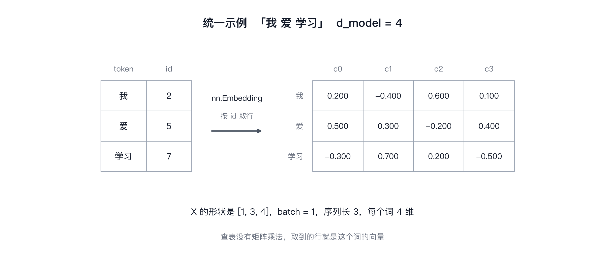

图里左边是三个 token 和它们的 id，右边是查表得到的矩阵 $X$。id 2、5、7 分别取出嵌入矩阵对应的三行。形状从 `[1, 3]` 变成 `[1, 3, 4]`，序列长度不变，每个位置由一个整数 id 变成四维向量。图中的具体数值只用于演示；`nn.Embedding` 的默认初始化不保证所有值都落在某个固定区间内。代码随后会按 `sqrt(d_model)` 缩放这些向量。

### 为什么要对词向量进行缩放

这里的缩放已写在 `InputEmbedding.forward()` 中。经典 Transformer 将嵌入乘以 $\sqrt{d_{model}}$，再与位置编码相加。这个缩放是模型设计的一部分，一般用均值为 0、方差为 σ 的平方的分布初始化。很多实现里 σ 取得比较小。如果词向量分量太小，加上位置编码后， **位置信息会盖过词义信息** 。模型相当于主要在学“第几个词”，而不是“什么词”，语义信号被稀释了。

如果改用 RoPE，位置信息通常通过旋转 query 和 key 注入注意力计算，不再以同样的方式和嵌入相加。是否保留嵌入缩放应按目标模型的具体设计决定，不能只因为使用 RoPE 就机械地删除缩放。

## 位置编码

单看注意力计算，它没有直接接收 token 的位置编号，无法区分同一个词在不同位置代表的不同含义。例如，我爱猫 和 猫爱我 这两句话是不一样的，但是注意力计算出来就无法区分。所以模型需要额外的位置线索才能区分先后。位置编码就是为表示补上这部分信息。

上一步得到的 $X$ 是「我 爱 学习」三个词的词向量，形状 [1, 3, 4]，位置编码 $\mathrm{PE}$ 的形状和它一样，两者逐元素相加得到 $Z = X + \mathrm{PE}$。

```python
class PositionalEncoding(nn.Module):
    def __init__(self, d_model: int, seq_len: int, dropout: float):
        super().__init__()
        self.dropout = nn.Dropout(dropout)

        pe = torch.zeros(seq_len, d_model)
        position = torch.arange(seq_len, dtype=torch.float).unsqueeze(1)
        div_term = torch.exp(
            torch.arange(0, d_model, 2, dtype=torch.float)
            * (-math.log(10000.0) / d_model)
        )
        pe[:, 0::2] = torch.sin(position * div_term)
        # 奇数维度时，cos 所需频率项比 div_term 少一个。
        odd_width = pe[:, 1::2].shape[1]
        pe[:, 1::2] = torch.cos(position * div_term[:odd_width])
        self.register_buffer("pe", pe.unsqueeze(0))

    def forward(self, x):
        x = x + self.pe[:, :x.shape[1], :].detach()
        return self.dropout(x)
```

先核对形状。`position` 的形状是 `[seq_len, 1]`，`div_term` 的长度为 `ceil(d_model / 2)`。广播**（从右往左对齐）**相乘后得到 `[seq_len, ceil(d_model / 2)]`，正好填入 `pe` 的偶数列。奇数列也使用相同频率，但若 `d_model` 是奇数，需要截取对应数量的频率项。

$$
\mathrm{PE}(pos,2i)=\sin\left(\frac{pos}{10000^{2i/d_{model}}}\right)
$$

$$
\mathrm{PE}(pos,2i+1)=\cos\left(\frac{pos}{10000^{2i/d_{model}}}\right)
$$

再看那行指数运算。公式要算 $\dfrac{pos}{10000^{2i/d_{model}}}$，直接写幂再取倒数，指数一大就溢出。换成 $\exp\left(2i \cdot \dfrac{-\ln 10000}{d_{model}}\right)$，幂运算变成乘加，数值上稳得多。div_term 的第 $i$ 项就是 $10000^{-2i/d_{model}}$，一个被缩小的频率。

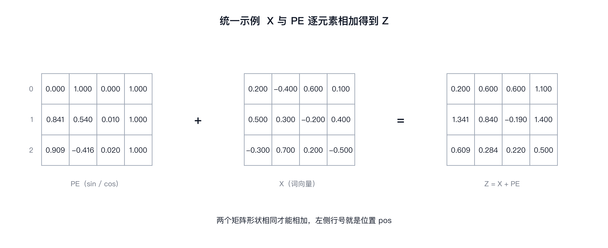

例子里 $d_{model}=4$，`div_term` 有两项，分别是 1 和 0.01。偶数维使用正弦，紧随其后的奇数维使用同一频率的余弦。位置为 0 时，每组的正弦值为 0、余弦值为 1；位置为 2 时，低频项的变化幅度较小。位置编码与缩放后的嵌入逐元素相加，结果仍为 `[1, 3, 4]`。

### 这里讲一下unsqueeze

unsqueezze(n)是在第n层外套一层括号。例如：[0, 1, 2] 本质上是两层，最外层也是第0层是 [	] 中括号，第一层是元素 0, 1, 2 。使用unsqueeze(1)后，会在第一层套上一层括号，也就是变成了

```
第 0 层		  [	     ]

第 1 层		[0], [1], [2]

第 2 层		   0, 1, 2
```

矩阵就变成了 [[0], [1], [2]] 这样的形状。

与 RoPE 位置编码的区别

RoPE 是许多现代语言模型采用的位置编码方案之一，做法和三角编码不同。

三角编码给的是绝对位置，好处是序列变长时不用重新训练，代价是位置信息在第一层之前就加进了表示，之后每一层都要带着它走。ROPE 换了个做法，转的是 query 和 key 的相位，位置关系在每层注意力里重新参与计算，它在长上下文场景中的表现取决于具体模型和外推方法，不能仅凭使用 RoPE 就保证长度外推效果。

换成 RoPE 后，位置通常通过旋转 query 和 key 注入注意力计算，不再使用这里的加法式位置编码。嵌入缩放是否保留，应根据所复现模型的配置决定。

## 层归一化

残差连接之前要先做归一化，它沿最后一维计算总体方差，并逐特征学习缩放和平移参数，计算方式与 `nn.LayerNorm` 一致；本例把 `eps` 设为 `1e-6`，与 PyTorch 默认值 `1e-5` 不同。

```python
class LayerNormalization(nn.Module):
    def __init__(self, d_model : int, eps: float = 10 ** -6):
        super().__init__()
        self.eps = eps
        self.alpha = nn.Parameter(torch.ones(d_model))
        self.bias = nn.Parameter(torch.zeros(d_model))

    def forward(self, x):
        mean = x.mean(dim=-1, keepdim=True)
        var = x.var(dim=-1, keepdim=True, unbiased=False)
        normalized = (x - mean) / torch.sqrt(var + self.eps)
        return self.alpha * normalized + self.bias
```

forward 沿最后一维计算均值和总体方差，再用 `sqrt(var + eps)` 做归一化，最后用可学习的 `alpha` 和 `bias` 逐特征缩放、平移。`keepdim=True` 保留最后一维，方便广播。这里使用 `unbiased=False`，与 PyTorch `nn.LayerNorm` 的方差计算方式一致；`alpha` 和 `bias` 的形状是 `[d_model]`，每个特征都有自己的参数。

$$
\mathrm{LayerNorm}(x) = \alpha \odot \frac{x - \mu}{\sqrt{\sigma^2 + \epsilon}} + \beta
$$

其中 $\mu$ 是沿最后一维的均值，$\sigma^2$ 是总体方差，$\epsilon$ 用于避免分母过小。本例取 $10^{-6}$；PyTorch `nn.LayerNorm` 的默认 `eps` 是 $10^{-5}$。注意，`eps` 加在方差上，再对结果开平方。

* dim = -1 取的是 [batch_size, seq_len, d_model] 其中的 d_model 特征维。

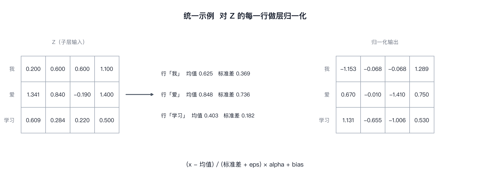

图里还是「我 爱 学习」这个例子，用的是上一步加完位置编码的 $Z$，形状 `[1, 3, 4]`。三行各自计算均值和方差，行与行之间互不影响。取「爱」这一行，图中给出的输入数值是 `[1.341, 0.840, -0.190, 1.400]`。归一化结果应按上面的代码重新计算；具体数值会随输入、方差定义和 `eps` 设置而变化。这里关注的是计算步骤：减去该行均值，再除以加上 `eps` 后的总体标准差。

### LayerNorm 在子层中的作用

这个类被 ResidualConnection 调用，顺序是先归一化再进子层。本实现把归一化放在每个子层之前，属于 Pre-LN 结构。

## 前馈网络

注意力会把不同位置的信息汇集起来。前馈层做的是另一件事，它逐位置处理输入，每一行都使用同一套线性层参数，计算时不直接读取相邻 token。

```python
class FeedForwardBlock(nn.Module):
    def __init__(self, d_model : int, d_ff : int, dropout : float):
        super().__init__()
        self.Linear1 = nn.Linear(d_model, d_ff)
        self.dropout = nn.Dropout(dropout)
        self.Linear2 = nn.Linear(d_ff, d_model)

    def forward(self, x):
        return self.Linear2(self.dropout(torch.relu(self.Linear1(x))))
```

输入形状为 `[batch, seq_len, d_model]`。第一个 `Linear` 把最后一维映射到 $d_{ff}$，随后代码明确使用 `ReLU`，再经过 dropout。第二个 `Linear` 把维度映射回 $d_{model}$。ReLU 和 dropout 都不改变张量形状。若要改用 GELU，需要显式修改激活函数代码。

$$
\mathrm{FFN}(x) = \max(0,\ xW_1 + b_1)W_2 + b_2
$$

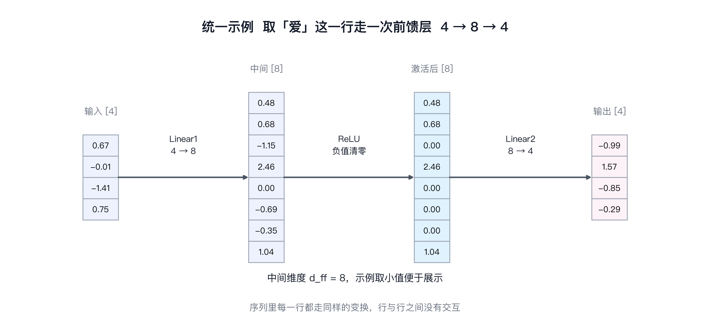

还是这个例子，$d_{model}=4$、$d_{ff}=8$。维度变化可以明确写成 `[1, 3, 4] → [1, 3, 8] → [1, 3, 4]`。具体输出数值取决于线性层权重、偏置和输入；如果没有给出这些参数或固定随机种子，就不能把某组数字当成可复算的确定结果。

## 残差连接

残差连接把子层的输出加回原始输入，让信息和梯度保留一条直接通路。它常用于缓解深层网络训练中的优化困难，但实际效果仍取决于网络结构和训练设置。

```python
class ResidualConnection(nn.Module):
    def __init__(self, d_model : int, dropout : float):
        super().__init__()
        self.dropout = nn.Dropout(dropout)
        self.norm = LayerNormalization(d_model)

    def forward(self, x, sublayer):
        return x + self.dropout(sublayer(self.norm(x)))
```

forward 收到 $x$ 和一个 sublayer。sublayer 可以是模块，也可以是 lambda，只要能吃张量、吐张量就行。EncoderBlock 正是靠这一点，把自注意力包成 lambda 塞进来。

计算顺序是先归一化，再进子层，最后过 dropout 加上输入 $x$，公式写出来就是

$$
y = x + \operatorname{Dropout}\left(\mathrm{Sublayer}\left(\mathrm{LN}(x)\right)\right)
$$

归一化放在子层输入上，是 pre-LN 的写法。

**Post-LN（原始 Transformer 论文用的）**

```python
x = LayerNorm(x + Dropout(Sublayer(x)))
```

先做子层，残差相加，最后归一化。

**Pre-LN**

```python
x = x + Dropout(Sublayer(LayerNorm(x)))
```

先归一化，子层，Dropout，再加回残差。归一化在子层之前，残差是干净的恒等通路。

### Pre-LN 与 Post-LN 的区别

Pre-LN 的残差支路保留恒等映射，梯度可以沿这条路径回传，因此在许多深层设置中更容易优化。Post-LN 在残差相加之后执行归一化，训练稳定性会更依赖初始化和优化器设置。两种结构都能训练成功，是否需要 warmup、哪种最终效果更好，取决于模型规模、任务和训练配置，不能一概而论。

dropout 加在子层输出上，不作用于求和结果。两种做法都有人用，差别在于 dropout 会不会连残差那一份一起丢。加在子层输出上，$x$ 原样一路传到底，梯度回传时有一条直通道。深一点的模型靠这条通道撑住训练。

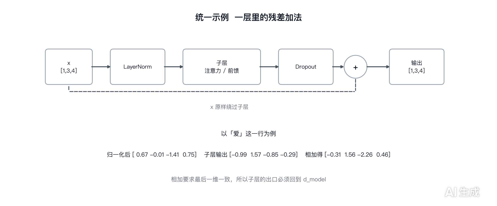

看「爱」这个位置，残差连接会把子层输出与进入该子层前的原始表示相加。两者形状必须一致，具体数值则由当前输入和子层参数决定。残差结构提供了直接的信息通路，但不能据此断言子层只会学习很小的增量。

### 残差相加的张量形状约束

两个张量相加，最后一维必须相同。注意力和前馈都设计成进去多少出来多少，就是为了这一句。$d_{ff}$ 随便调，出口必须压回 $d_{model}$，不然残差这一步过不去。

## 多头注意力

多头注意力的代码相对集中，但形状变换比较多。这里有四个不带 bias 的线性投影，参数总量为 $4\,d_{model}^{2}$。当 $d_{model}=512$ 时，约有 105 万个权重参数。

缩放点积注意力本身写下来只有一行。

$$
\operatorname{softmax}\left(\dfrac{QK^{\top}}{\sqrt{d_k}}\right)V
$$

```python
class MultiHeadAttentionBlock(nn.Module):

    def __init__(self, d_model : int, h : int, dropout : float):
        super().__init__()
        self.d_model = d_model
        self.h = h
        if h <= 0 or d_model % h != 0:
            raise ValueError("h must be positive and d_model must be divisible by h")
        self.d_k = d_model // h
        self.wq = nn.Linear(d_model, d_model, bias = False)
        self.wk = nn.Linear(d_model, d_model, bias = False)
        self.wv = nn.Linear(d_model, d_model, bias = False)
        self.wo = nn.Linear(d_model, d_model, bias = False)

        self.dropout = nn.Dropout(dropout)

    @staticmethod
    def attention(query, key, value, dropout : nn.Dropout, mask):
        d_k = query.shape[-1]
        attention_score = (query @ key.transpose(-2, -1)) / math.sqrt(d_k)

        if mask is not None:
            attention_score = attention_score.masked_fill(
                mask == 0, torch.finfo(attention_score.dtype).min
            )

        attention_score = attention_score.softmax(dim = -1)

        if dropout is not None:
            attention_score = dropout(attention_score)

        return (attention_score @ value), attention_score

    def forward(self, q, k, v, mask):
        query = self.wq(q)
        key = self.wk(k)
        value = self.wv(v)

        query = query.view(query.shape[0], query.shape[1], -1, self.d_k).transpose(1, 2)
        key = key.view(key.shape[0], key.shape[1], -1, self.d_k).transpose(1, 2)
        value = value.view(value.shape[0], value.shape[1], -1, self.d_k).transpose(1, 2)

        x, self.attention_scores = MultiHeadAttentionBlock.attention(query, key, value, self.dropout, mask)

        x = x.transpose(1, 2).contiguous().view(x.shape[0], -1, self.h * self.d_k)

        return self.wo(x)
```

多头是沿特征维拆出来的。每个头的维度是 $d_k=d_{model}/h$，因此 $d_{model}$ 必须能被头数整除。512 维配 8 个头时，每头是 64 维；配 7 个头则无法整除，余下的维度会让后续 reshape 失败。构造函数现在会提前检查整除条件，配置不合法时直接抛出 `ValueError`。各个头分别在自己的特征子空间中计算注意力。

### 多头注意力的张量拆分

```python
query = query.view(query.shape[0], query.shape[1], -1, self.d_k).transpose(1, 2)
```

这里显式读取 batch 和 seq_len，并用一个 `-1` 让 PyTorch 推断头数。`view` 的形状参数最多只能有一个 `-1`，因此其余维度要明确给出。

[batch, seq_len, d_model] 先拆成 [batch, seq_len, h, d_k]，再把 h 换到前面，得到 [batch, h, seq_len, d_k]。三块张量做同样的处理，之后 batched matmul 会把 batch 和头一起算掉。

转置后张量通常不再连续，因此在输出端先 `transpose` 回 `[batch, seq_len, h, d_k]`，再调用 `contiguous()`，最后 `view` 成 `[batch, seq_len, h * d_k]`。`contiguous()` 在需要时会复制数据；若内存布局已经连续，则不一定需要复制。

### 缩放点积注意力的计算接口

它不需要 self。$d_k$ 直接从 query 的最后一维取，比从 self 里读更省事，也方便单独测。

它返回两份东西，加权求和的结果和注意力权重，权重是从同一处算出来的中间产物。forward 把两份都接住，只把前一份继续往下传。

调用的形参顺序是 `attention(query, key, value, dropout, mask)`，dropout 在 mask 前面。传错参数是否立刻报错，取决于传入对象及后续操作；不要依赖错误一定会延迟到某一行才出现。

### 双头注意力的形状示例

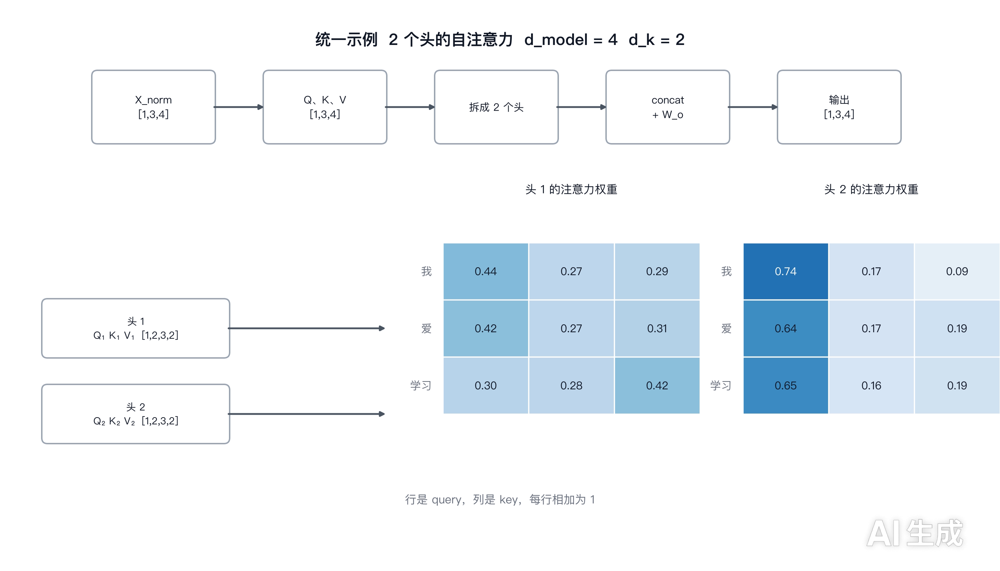

例子里 $d_{model}=4$、$h=2$，每个头分到 2 维。输入形状为 `[1, 3, 4]`，拆头后变成 `[1, 2, 3, 2]`。图的下半部分是两头算出来的注意力权重，每张 $3 \times 3$，行是 query，列是 key。

图中每个头的权重矩阵都是 $3\times3$。每一行对应一个 query 位置，每一列对应一个 key 位置；在未应用 dropout 的 softmax 权重上，每行之和为 1。不同头使用不同的投影参数，因此可能学习到不同的关注模式。具体权重数值必须由输入和实际参数计算，不能只从张量形状推得。

## 编码器

编码器的代码分成两块。一块是反复堆叠的单元，EncoderBlock，另一块是把单元装起来的容器，Encoder。前面几节拆开的那些零件，到这里开始拼成一个完整的部分。

```python
class  EncoderBlock(nn.Module):
    def __init__(self, features : int, self_attention : MultiHeadAttentionBlock, feed_forward : FeedForwardBlock, dropout : float):
        super().__init__()
        self.self_attention = self_attention
        self.feed_forward = feed_forward

        self.residual_connections = nn.ModuleList([ResidualConnection(features, dropout) for _ in range(2)])

    def forward(self, x, mask):
        x = self.residual_connections[0](x, lambda x: self.self_attention(x, x, x, mask))
        x = self.residual_connections[1](x, self.feed_forward)

        return x
```

EncoderBlock 依次调用自注意力和前馈网络，每个子层外面都有一条残差连接。两个模块在构造时由外部传入，因此上层可以统一创建和管理参数。需要六层时，就创建六个独立的 EncoderBlock 实例，再放进列表。

features 是特征维度，往下传给 ResidualConnection，再进 LayerNormalization。块自己不直接用它做运算，但每一层都得知道这个数，不然归一化建不出来。

这里要使用 nn.ModuleList，而不是普通 Python list。PyTorch 通过模块注册机制追踪子模块，普通列表里的模块不会自动注册，参数可能不会进入优化器，调用 .to(device) 时也不会随模型一起迁移。这类问题未必会立刻抛出异常，排查起来反而麻烦。

### 使用 lambda 适配自注意力的调用接口

残差包装一次只往子层里塞一个参数，自注意力需要四个。lambda 在这里补上 query、key、value 三份输入和 mask，$qkv$ 都取自同一份 $x$，自注意力里「自」的意思就在这。编码器双向看，不需要遮未来位置，mask 只负责挡填充。

lambda 里的 $x$ 和外层的 $x$ 同名，换成 functools.partial 也行，或者给残差包装多接几个参数。写法本身没关系，读代码的人能一眼看出这里在做什么就行。

### EncoderBlock 的前向计算流程

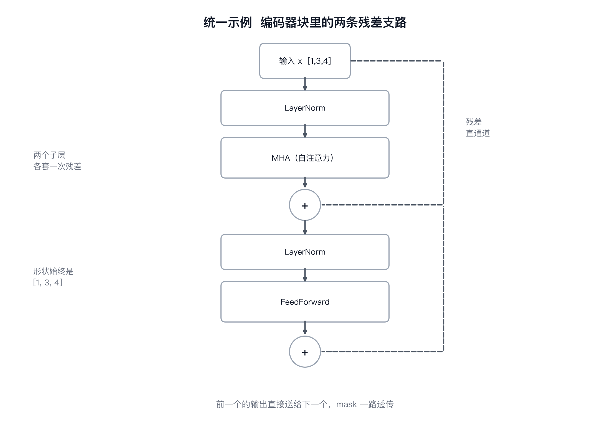

图里是「我 爱 学习」这个例子里一层的完整路径。$x$ 先过 LayerNorm，进自注意力，过 dropout，再和原来的 $x$ 相加得到中间结果。中间结果再过一次 LayerNorm，进前馈层，过 dropout，和前一个结果相加，这一层的输出就成了。

两条虚线是残差支路。归一化和 dropout 都在支路之外，只有子层本身在支路里。输入输出都是 [1, 3, 4]，中间任何一个位置的形状都没有变，这正是能堆很多层的前提。

### Encoder 的层堆叠与输出归一化

```python
class Encoder(nn.Module):
    def __init__(self, features : int, layers : nn.ModuleList) -> None:
        super().__init__()
        self.layers = layers
        self.norm = LayerNormalization(features)

    def forward(self, x, mask):
        for layer in self.layers:
            x = layer(x, mask)

        return self.norm(x)
```

一层内部怎么排布由块定下来，堆几层、出口要不要再归一化，由容器决定。层数就这样成了配置项，六层改十二层不用动块里的代码。

送进来的是 nn.ModuleList，照原样存住。forward 依次调用每一层，前一个的输出交给后一个，mask 一路透传。features 同样只用来建出口那个 LayerNormalization。

编码器出口再执行一次归一化是这份实现的设计选择。它不会改变张量形状，但会改变输出数值。

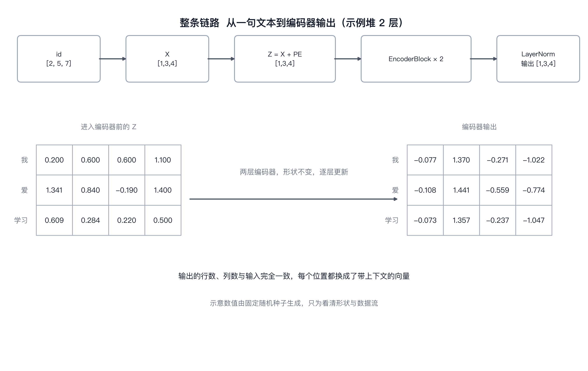

回到「我 爱 学习」这句。id 是 [2, 5, 7]，查表得到 $X$，加上位置编码得到 $Z$，$Z$ 进编码器，经过两层编码器块，最后过一次 LayerNorm，输出还是 3 行 4 列。

每一层的输出都交给下一层当输入，形状自始至终是 [1, 3, 4]。序列长度没有变，每个位置的向量被逐层改写，从只包含这个词本身的信息，变成带着整句话上下文的表示。编码器输出交给解码器做交叉注意力时，形状上不需要任何转换。

### 编码器堆叠时的参数管理

层与层之间参数不共享，每一层是独立实例。用循环生成时确保每一份都是新建的，别让所有层指向同一个对象，那样堆出来的只是一层重复调用，参数和数据流都会出问题。

同一个注意力块交给两个编码器块，参数会共享，梯度也会一起累加。除非清楚知道自己在做什么，否则每一层都建一份新的。

调试先拿两层跑通。编码器不改序列长度，[batch, seq_len, d_model] 进去再原样出来，这句可以写成断言挂在 forward 里，接解码器的时候能早一步发现形状对不上。

### 编码器输出的形状与语义

从查表到归一化，每一步都停在同一句话上。序列长度、维度、位置编码的形状，全部保持着同一个约定。这套约定到了解码器那边照样成立，只是注意力从一次变成两次，mask 也随之分岔。

## 解码器

Decoder 和 Encoder 都由重复堆叠的 block 与负责管理层数的容器组成。DecoderBlock 多出交叉注意力这一层，输入来源也随之变化。先看单层，再看堆叠容器。

```python
class DecoderBlock(nn.Module):
    def __init__(self, features : int, self_attention_block : MultiHeadAttentionBlock, cross_attention_block : MultiHeadAttentionBlock, feed_forward_block : FeedForwardBlock, dropout : float):
        super().__init__()
        self.self_attention_block = self_attention_block
        self.cross_attention_block = cross_attention_block
        self.feed_forward_block = feed_forward_block

        self.residual_connections = nn.ModuleList([ResidualConnection(features, dropout) for _in in range(3)])

    def forward(self, x, encoder_output, src_mask, tgt_mask):
        x = self.residual_connections[0](x, lambda x : self.self_attention_block(x, x, x, tgt_mask))
        x = self.residual_connections[1](x, lambda x : self.cross_attention_block(x, encoder_output, encoder_output, src_mask))
        x = self.residual_connections[2](x, self.feed_forward_block)

        return x
```

三个子层，每个都套一层残差，ModuleList 里也就有三个元素。自注意力的 $qkv$ 全部取自解码器输入，交叉注意力的 $q$ 取自解码器、$k$ 和 $v$ 取自编码器输出，前馈层和编码器里那个完全一样。

forward 的参数比编码器块多了一个 encoder_output。src_mask 和 tgt_mask 也分开传，第一个管源句的填充位，第二个管目标句的填充位和未来位置。

features 还是那句老话，用来建三层残差里的归一化，块自己不做维度运算。

### 交叉注意力如何融合源序列信息

自注意力内部三块张量同源，交叉注意力把 $k$ 和 $v$ 换成了编码器的输出。解码器当前这个位置拿着自己的 query，去编码器输出的每一个位置上取一次权重，把整句源语言的表示按相关性加权取回来。生成时前面那个词该看源句里的哪一部分，就靠这一层。

形状上能对上是因为编码器不改序列长度，交出来的还是 [batch, src_len, d_model]。query 是 [batch, tgt_len, d_model]，两个长度不一样也不会出问题，矩阵乘法只要求最后一维一致。注意力的分数矩阵因此是 $tgt\_len \times src\_len$ 的矩形，不再是方阵。

两个注意力不能合并成一个。自注意力和交叉注意力各自有独立的 wq、wk、wv、wo，参数不共享，作用也不同，一个是让目标句内部对齐，一个是让目标句和源句对齐。

### 解码器中的两类注意力掩码

自注意力这里传的是 tgt_mask，它同时遮两样东西，目标句的填充位，以及每个位置之后的未来 token。训练时整个目标句一次性送进来，第 1 个位置不该看到第 2 个位置，否则模型抄一遍答案就完事了。

未来位置的遮罩是一个上三角的布尔矩阵，对角线开始往右全是 0。构造的时候和填充 mask 按位与起来，得到一张既挡填充又挡未来的方阵。

交叉注意力那里传的是 src_mask，只遮源句的填充位，不需要遮因果。解码器当前这个位置可以看完整的源句，看未来位置这种问题在源句上不存在。

mask 在 `attention()` 里的用法一致。被屏蔽的位置会先填入当前张量数据类型可表示的最小有限值，再经过 softmax 后得到接近 0 的权重。要避免一整行全部被屏蔽，否则注意力权重就不再具有预期语义。两个 mask 的语义不同，形状需能按广播规则匹配注意力分数矩阵。

### DecoderBlock 的前向计算流程

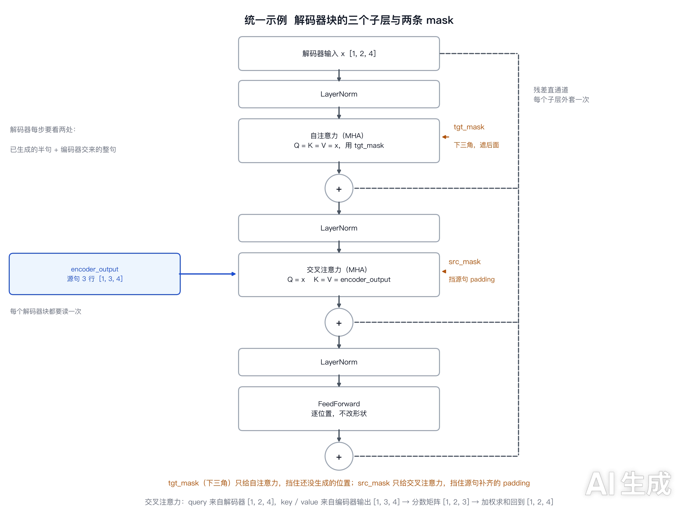

还是「我 爱 学习」这个例子，这次让解码器生成它的英文译文。假设已经生成了前两个词，解码器输入是 [BOS, I]，形状 [1, 2, 4]。编码器输出是 3 行 4 列，对应「我 爱 学习」三个位置。

三层前后是串联的。自注意力在 [1, 2, 4] 上算，tgt_mask 是 $2 \times 2$ 的下三角。交叉注意力里 query 走 [1, 2, 4]，key 和 value 走 [1, 3, 4]，分数矩阵是 $2 \times 3$。前馈层维度不变，出口还是 [1, 2, 4]。

序列长度开始动了。编码器那边进去多少出来多少，解码器这边进去 2 行出来还是 2 行，但下一步会变成 3 行，因为生成在往下走。这是解码器跟编码器最大的不同。

### Decoder 的层堆叠与最终归一化

```python
class Decoder(nn.Module):
    def __init__(self, features : int, layers : nn.ModuleList) -> None:
        super().__init__()
        self.layers = layers
        self.norm = LayerNormalization(features)

    def forward(self, x, encoder_output, src_mask, tgt_mask):
        for layer in self.layers:
            x = layer(x, encoder_output, src_mask, tgt_mask)

        return self.norm(x)
```

跟 Encoder 的写法几乎一样，差别只在参数和调用。每一层都要拿到 encoder_output 和两张 mask，原样转发下去。出口的 LayerNormalization 也保留，理由和编码器那边相同。

层数、mask 构造、词表映射都不在这个文件里，它们属于组装环节。Encoder 和 Decoder 各自管好堆叠和出口归一化，剩下的交给上层拼。

### 从隐藏状态到词表 logits

解码器交出的是 [batch, tgt_len, d_model]，最后一步是过投影层，把 $d_{model}$ 映射到词表大小。

```python
self.projection_layer = nn.Linear(d_model, vocab_size)
```

输出形状 [batch, tgt_len, vocab_size]，最后一维是词表上每个词的分数。训练时和目标序列算交叉熵，推理时取 argmax 拿到下一个 token。这一层也是独立的一个类，放在下一节讲。

### 训练阶段与自回归生成的区别

训练时目标句一次全部送进来，一张上三角 mask 就够，位置之间靠并行算。自回归生成时，每一步根据已有前缀预测下一个 token。若不使用缓存，就会重复计算前缀；使用 KV cache 可以复用先前的 key 和 value。缓存是推理优化，不改变模型定义。

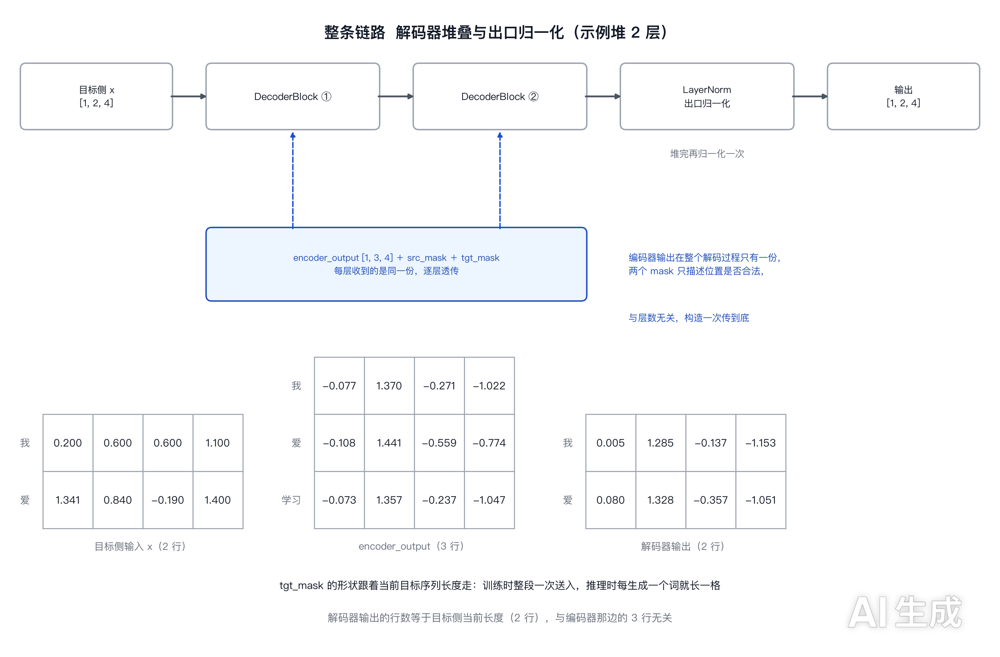

同一句「我 爱 学习」。解码器输入是已经生成的部分，加上位置编码之后进解码器块，逐层做自注意力、交叉注意力、前馈，最后过一次 LayerNorm，输出形状 [1, tgt_len, 4]。

编码器的输出在每一层都被用一次，交叉注意力把它读了三遍。源句的表示就这样反复参与目标句的生成，直到最后一个位置也具备了完整的上下文。

### 解码器实现中的关键约束

mask 传错是常见问题。解码器自注意力使用 `tgt_mask`，交叉注意力使用 `src_mask`。错误的 mask 有时仍能让前向计算继续执行，但会改变模型可见的信息，训练损失下降也不能证明遮罩正确。分不清的时候就拿一句短句在推理模式下跑一遍，看第二个位置有没有受到后面 token 的影响。

自注意力里 $q$、$k$、$v$ 三个张量必须是同一份输入。写成 cross_attention(x, encoder_output, encoder_output, mask) 这种形式放到自注意力上，形状宽松的时候不报错，模型却在看别的位置。

前向顺序不能调。自注意力必须在交叉注意力之前，交叉注意力才能拿到已经经过目标句内部对齐的表示。调换顺序模型也能训，只是多了一层对不齐的信息，收敛更慢或者更差。

## 投影层

解码器输出仍是隐藏向量。ProjectionLayer 用一个线性层把最后一维映射到目标词表大小，得到每个 token 的分数。

```python
class ProjectionLayer(nn.Module):
    def __init__(self, d_model, vocab_size):
        super().__init__()
        self.proj = nn.Linear(d_model, vocab_size)

    def forward(self, x):
        return self.proj(x)
```

一个线性层，进去是 $d_{model}$ 维，出来是词表大小。没有激活，没有 dropout，也没有残差，做的事情只有一次线性映射。

### 投影层的输入与输出形状

解码器交出来的张量是 [batch, tgt_len, d_model]。线性层只作用于最后一维，前面两维原样保留，输出是 [batch, tgt_len, vocab_size]。每一个位置都得到一整套词表分数。

还是「我 爱 学习」这个例子，$d_{model}$ 是 4，词表按 10 算，输出就是 [1, tgt_len, 10]。第 $t$ 行的 10 个数，是那个位置上下一个词属于词表中每个词的分数。

这里输出的是 logits，不是概率。需要概率时可以沿词表维做 $\operatorname{softmax}$。训练若使用 `CrossEntropyLoss`，应直接传 logits，因为该损失内部会执行等价于 `log_softmax` 的稳定计算；不要先把 logits 变成概率再传给它。

### 线性投影与词表 logits

嵌入层把词 id 映射成向量，投影层把这个方向的映射反过来。在 PyTorch 中，嵌入层权重形状是 `[vocab_size, d_model]`；`nn.Linear(d_model, vocab_size)` 的 `weight` 形状也是 `[vocab_size, d_model]`，因为 `nn.Linear` 按 `[out_features, in_features]` 存储权重。两者形状相同，可以共享同一个参数，不需要转置。

经典 Transformer 相关实现中常见输入嵌入与输出投影共享权重。词表大小为 32000、$d_{model}=512$ 时，一张这样的矩阵包含 16,384,000 个参数。是否共享取决于模型设计和词表设置。

当前 `ProjectionLayer` 没有与嵌入层共享参数。若希望共享，并且两层的词表大小和特征维度一致，可以在模型组装时将 `projection_layer.proj.weight` 绑定到对应嵌入层的 `embedding.weight`。源、目标词表不同的编码器-解码器模型通常不能直接把源嵌入与目标投影绑定。

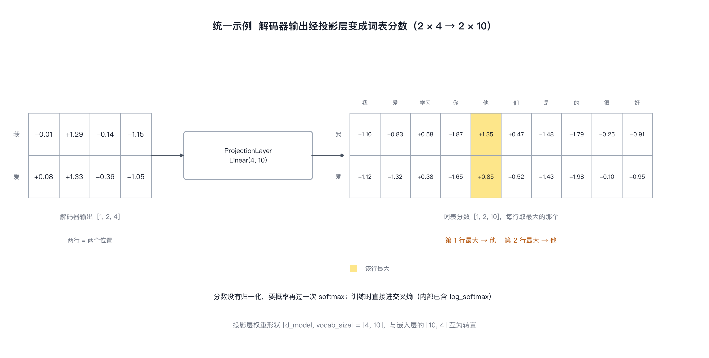

图里是同一句「我 爱 学习」。解码器输出两行四列，过完线性层变成两行十列，每行十个分数对应词表里的十个词。取最大的那个，就是这一步生成的 token。

### 投影层在整体计算图中的位置

它排在解码器后面，是整个模型的最后一层。序列长度在这一层不受影响，只改最后一维，解码器那边进来多长，输出就有多长。

训练时它的结果直接进损失函数，推理时再多一步取 argmax。同一份输出，两种用法，差别只在后面接谁。

## 组装完整的 Transformer

前面的类各自完成一段计算，Transformer 类负责把它们按顺序接起来。

```python
class Transformer(nn.Module):
    def __init__(self, encoder : Encoder, decoder : Decoder, src_embed : InputEmbedding, tgt_embed : InputEmbedding, src_pos : PositionalEncoding, tgt_pos : PositionalEncoding, projection_layer : ProjectionLayer):
        super().__init__()
        self.encoder = encoder
        self.decoder = decoder
        self.src_embed = src_embed
        self.tgt_embed = tgt_embed
        self.src_pos = src_pos
        self.tgt_pos = tgt_pos
        self.projection_layer = projection_layer
```

七个部件由外部构造好再传进来，包括编码器、解码器、两套嵌入、两套位置编码和一个投影层。这个类负责按顺序调用它们。补上的 `forward` 把编码、解码和投影串成一次完整前向，训练时可以调用 `model(src, tgt, src_mask, tgt_mask)`。目标序列通常需要在训练数据准备阶段右移，并配合因果 mask，避免模型看到当前要预测的 token。

源句和目标句各有一套嵌入和位置编码。两者结构一样，参数不共享，词表也可能不同。源语言和目标语言的词表大小分别传进去，两个 InputEmbedding 各自持有自己的查找表。

### encode、decode 与 project 三个接口

```python
    def encode(self, src, src_mask):
        src = self.src_embed(src)
        src = self.src_pos(src)
        return self.encoder(src, src_mask)

    def decode(self, encoder_output, src_mask, tgt, tgt_mask):
        tgt = self.tgt_embed(tgt)
        tgt = self.tgt_pos(tgt)
        return self.decoder(tgt, encoder_output, src_mask, tgt_mask)

    def project(self, x):
        return self.projection_layer(x)

    def forward(self, src, tgt, src_mask, tgt_mask):
        encoder_output = self.encode(src, src_mask)
        decoder_output = self.decode(encoder_output, src_mask, tgt, tgt_mask)
        return self.project(decoder_output)
```

encode 收源句的 id 和 mask，先查表，加位置编码，再进编码器。三步前面都写过，这里只是串起来。

decode 多一个 encoder_output，其余顺序一样。目标句走自己的嵌入和位置编码，然后进解码器，两张 mask 分别透传下去。

project 只有一行，把解码器输出交给投影层。单独拆出来，是因为它只在需要词表分数的时候才调。

### 使用 build_transformer 创建模型

```python
    @staticmethod
    def build_transformer(src_vocab_size : int, tgt_vocab_size : int, src_seq_len : int, tgt_seq_len : int, d_model : int=512, N : int=6, h : int=8, dropout : float=0.1, d_ff : int=2048) -> "Transformer":
        src_embed = InputEmbedding(d_model, src_vocab_size)
        tgt_embed = InputEmbedding(d_model, tgt_vocab_size)

        src_pos = PositionalEncoding(d_model, src_seq_len, dropout)
        tgt_pos = PositionalEncoding(d_model, tgt_seq_len, dropout)

        encoder_blocks = []
        for _i in range(N):
            encoder_self_attention_block = MultiHeadAttentionBlock(d_model, h, dropout)
            feed_forward_block = FeedForwardBlock(d_model, d_ff, dropout)
            encoder_block = EncoderBlock(d_model, encoder_self_attention_block, feed_forward_block, dropout)
            encoder_blocks.append(encoder_block)
```

一个静态方法把整套流程配好。前面那些类都要求部件从外面传进来，配参数的活就落在这里。

默认配置采用经典 Transformer Base 常见的数值：$d_{model}=512$、编码器和解码器各 $N=6$ 层、$h=8$ 个头、dropout 为 0.1、$d_{ff}=2048$。模型总参数量还会受词表大小、偏置设置和权重是否共享影响，因此不能仅凭这几个超参数断言固定的总参数量。

循环每次都会新建一组模块，因此各层参数独立。若把同一个模块实例反复放进多个层，参数就会共享，模型将变成多次调用同一组参数的结构，而不是标准配置中的独立层。

```python
        decoder_blocks = []
        for _i in range(N):
            decoder_self_attention_block = MultiHeadAttentionBlock(d_model, h, dropout)
            encoder_cross_attention_block = MultiHeadAttentionBlock(d_model, h, dropout)
            feed_forward_block = FeedForwardBlock(d_model, d_ff, dropout)
            decoder_block = DecoderBlock(d_model, decoder_self_attention_block, encoder_cross_attention_block, feed_forward_block, dropout)
            decoder_blocks.append(decoder_block)

        encoder = Encoder(d_model, nn.ModuleList(encoder_blocks))
        decoder = Decoder(d_model, nn.ModuleList(decoder_blocks))

        projection_layer = ProjectionLayer(d_model, tgt_vocab_size)

        transformer = Transformer(encoder, decoder, src_embed, tgt_embed, src_pos, tgt_pos, projection_layer)

        for p in transformer.parameters():
            if p.dim() > 1:
                nn.init.xavier_uniform_(p)

        return transformer
```

两个循环写得不一样。编码器每层只需要一份注意力，解码器每层要两份，一份自注意力，一份交叉注意力，所以解码器那边多建一个块。

位置编码按各自的序列长度构造。源句和目标句的最大长度常常不同，构造时分开传，forward 里再按实际长度切片。

组装好之后没有直接把实例返回，先留了个名字给下一步用。ModuleList 把两个列表包起来，投影层单独建一个，七个部件凑齐交给构造函数。

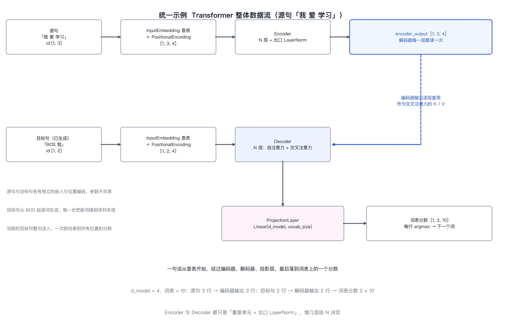

### 模型参数的初始化策略

新建完实例，最后一步是遍历整棵模块树的参数，挑出维度大于 1 的做一遍初始化。

```python
        for p in transformer.parameters():
            if p.dim() > 1:
                nn.init.xavier_uniform_(p)
```

那行维度判断不是随手加的过滤器。nn.Linear 里的 weight 是二维，落在被初始化的范围里；同一层的 bias 是一维，跳过。LayerNormalization 里的 alpha 和 bias 都是一维，也跳过。这些一维量本来就有明确的默认值，缩放因子从 1 开始，偏置从 0 开始，再拿随机数覆盖只会把已经摆正的起点弄乱。

xavier_uniform_ 的取值区间由扇入扇出定，$U\left(-\sqrt{\dfrac{6}{fan_{in}+fan_{out}}},\ \sqrt{\dfrac{6}{fan_{in}+fan_{out}}}\right)$。它的目标是让每一层的输出方差和输入方差大致相等，信号往前传、梯度往回传都不至于被逐层放大或压扁。对编码器解码器各堆六层的结构，这件事在起点上就要交代清楚。

省掉这段遍历，参数就会保留各模块的默认初始化。PyTorch 的 `nn.Linear` 默认采用 Kaiming uniform 初始化，其取值范围与扇入有关；这里则对所有维度大于 1 的参数执行 Xavier uniform。不同初始化可能影响训练早期的数值表现，但不能单凭初始化方式保证收敛或最终效果。
